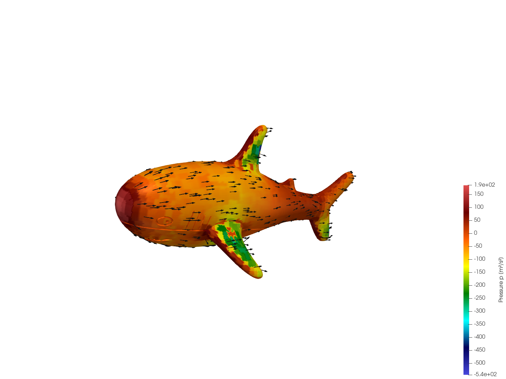
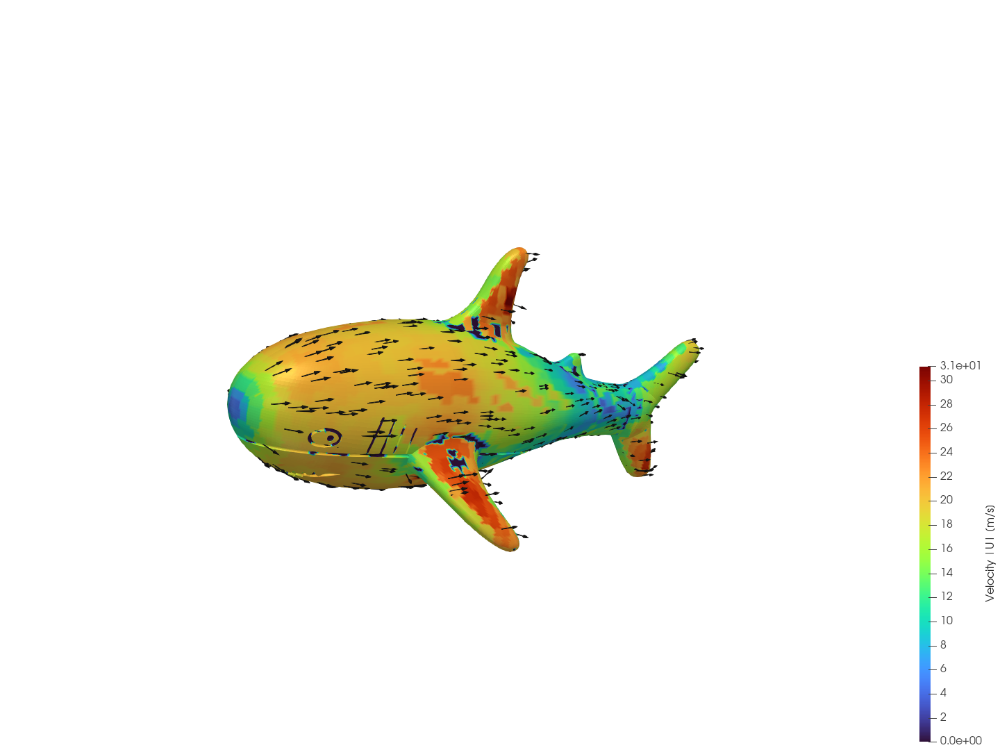
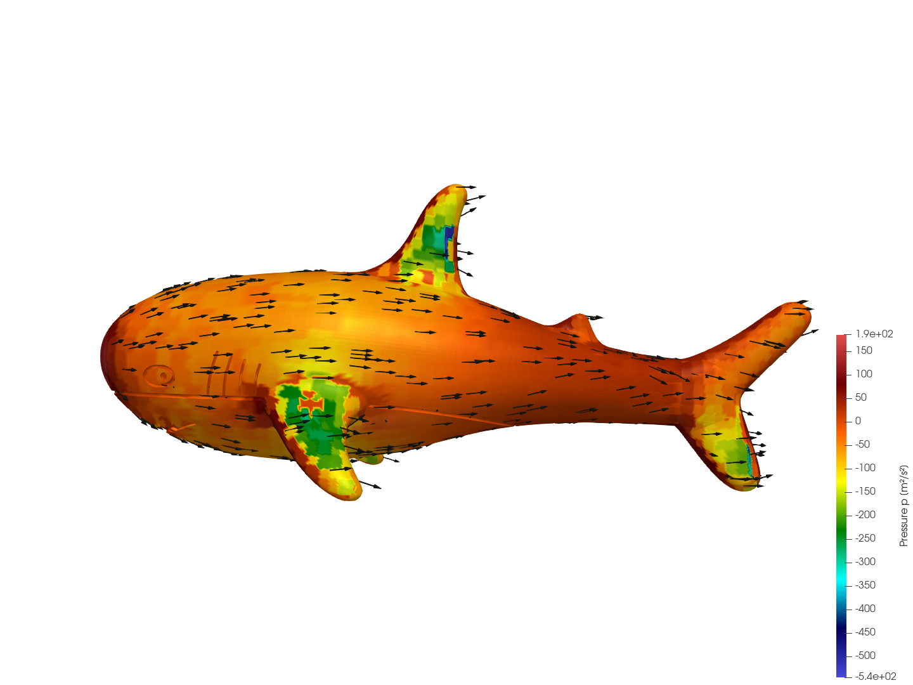
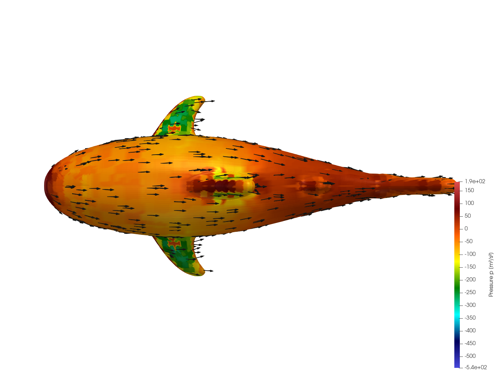

# Aerodynamics of Blåhaj (`blahaj_aero`) 🦈💨

Aerodynamic study of the IKEA **Blåhaj** (the beloved plushie shark) using OpenFOAM.

> **Why am I doing this?**  
> *'Cause it's ducking adorable.*
### Aerodynamics of a Blåhaj

| **Isometric Surface Pressure ($p$)** | **Isometric Velocity Magnitude ($\|U\|$)** |
| :---: | :---: |
|  |  |
| **Side Profile View** | **Top Planform View** |
|  |  |
---

## 📊 Aerodynamic Results

Simulated in OpenFOAM-v2606 using `simpleFoam` ($k$-$\omega$ SST turbulence model) at $U_\infty = 20\text{ m/s}$ (approx. $72\text{ km/h}$ / $45\text{ mph}$):

| Coefficient | Total | Pressure | Viscous (Skin Friction) |
| :--- | :---: | :---: | :---: |
| **Drag ($C_d$)** | **0.2208** | 0.1949 | 0.0259 |
| **Lift ($C_l$)** | **0.0732** | 0.0735 | -0.0003 |
| **Pitch Moment ($C_{m,\text{Pitch}}$)** | **0.0173** | 0.0179 | -0.0006 |
| **Side Force ($C_s$)** | **-0.0167** | -0.0167 | ~0.0000 |

### Reference Parameters
- **Reference Length ($l_{\text{ref}}$)**: $1.0\text{ m}$ (standard Blåhaj nose-to-tail length)
- **Reference Frontal Area ($A_{\text{ref}}$)**: $0.08\text{ m}^2$
- **Freestream Velocity ($U_\infty$)**: $20.0\text{ m/s}$ along $+X$
- **Air Density ($\rho_\infty$)**: $1.225\text{ kg/m}^3$

---

## 🛠️ Case Architecture

- **Solver**: `simpleFoam` (incompressible steady-state RANS)
- **Turbulence**: $k$-$\omega$ SST with wall functions
- **Mesh Generation**: 
  - Background wind tunnel generated via `blockMesh` ($X \in [-5, 15]\text{ m}, Y \in [-4, 4]\text{ m}, Z \in [0, 8]\text{ m}$)
  - Surface feature extraction via `surfaceFeatureExtract`
  - Automated shark body meshing & boundary layer insertion via parallel `snappyHexMesh` (~178k cells)
- **Parallelization**: 6-core MPI decomposition (`hierarchical`, $1 \times 6 \times 1$)
- **Orientation**: Shark snout facing into the oncoming wind ($-X$), dorsal fin pointing upward ($+Z$).

---

## 🚀 Quick Start

### 1. Prerequisites
- **OpenFOAM** (v2606 or compatible)
- **OpenMPI** (`mpirun`)
- **Python 3** (standard library only, for automated geometry validation)
- **ParaView** (optional, for 3D visualization)

### 2. Run the Simulation
To execute the automated end-to-end pipeline across 6 parallel cores:
```bash
./Allrun
```

The pipeline automatically:
1. Cleans previous simulation outputs.
2. Verifies and scales the Blåhaj STL geometry to $1.0\text{ m}$ placed inside the wind tunnel.
3. Generates the base mesh and partitions the domain.
4. Carves the shark surface and adds wall boundary layers with `snappyHexMesh`.
5. Runs `simpleFoam` to convergence.
6. Reconstructs mesh and time fields for post-processing.
7. Prints the final aerodynamic coefficients directly to the terminal!

### 3. Clean the Case
To reset the case to a clean repository state:
```bash
./Allclean
```

### 4. Post-Process Forces
To evaluate or re-evaluate force coefficients from the latest timestep:
```bash
mpirun -np 6 simpleFoam -parallel -postProcess -func forceCoeffs -latestTime
```
Continuous force time histories are saved in `postProcessing/forceCoeffs/0/coefficient.dat`.

### 5. Visualization in ParaView
Generate family-friendly ultra-plushy renders with real CFD surface contours and vector arrows on a pure white background:
```bash
pvpython scripts/visualize_shonk.py
```
To inspect interactively in ParaView:
```bash
paraview --state=ParaView/Shonk_UltraPlush.pvsm
```

---

## 🦈 Credits & Attribution
- **3D Model**: The 3D surface model was created by **Erin Rose** and obtained from [Printables: Blåhaj surface modelled](https://www.printables.com/model/1032676-blahaj-surface-modelled).
- **Original Case Template**: Derived from the OpenFOAM `motorBike` tutorial case.
